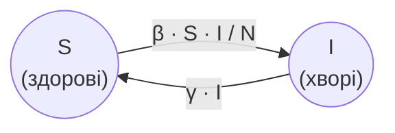

# Змінні - комбіноване присвоєння

## 🧩 Теоретичний матеріал

Часто оновлювати змінну потрібно **на певне значення**. Замість довгого запису `hp = hp - 20` у Python можна використати ***комбіноване присвоєння***: операція та присвоєння в одному знаку.

`-=` віднімає значення від змінної, `+=` додає значення до змінної.

Наприклад, здоров'я героя падає після ударів, а потім зростає після лікування:

```python
hp = 100
print("Здоров'я героя:", hp)
hp -= 20
print("Здоров'я героя:", hp)
hp -= 35
print("Здоров'я героя:", hp)
hp += 25
print("Здоров'я героя:", hp)
```
***Результат у консолі:***
```
Здоров'я героя: 100
Здоров'я героя: 80
Здоров'я героя: 45
Здоров'я героя: 70
```

Рядок `hp -= 20` означає те саме, що `hp = hp - 20`: взяти поточне значення `hp`, відняти `20` і записати результат назад у `hp`.

## 🎯 Практичне завдання

***Модель SIS*** описує поширення хвороби, після якої люди **одужують** і знову можуть захворіти. Кожну людину відносять до однієї з двох груп:

* `S` (susceptible) - здорові (можуть захворіти);
* `I` (infected) - хворі (можуть заразити інших і з часом одужати).

Загальна кількість людей $N = S + I$ не змінюється. Кожного дня частина здорових стає хворими, а частина хворих одужує і повертається до групи здорових:



Зміна кількості хворих за день:

$$\Delta I = \beta \cdot \frac{S \cdot I}{N} - \gamma \cdot I$$

де $\beta$ (`beta`) - ***коефіцієнт зараження***, а $\gamma$ (`gamma`) - ***коефіцієнт одужання***. Після цього стан оновлюють:

$$I_{t + 1} = I_t + \Delta I$$

$$S_{t + 1} = S_t - \Delta I$$

Доповни стартовий код: за допомогою циклу `while` або `for` повторюй крок оновлення і виведення стану для **наступних 100 днів**.

```python
S = float(input("Кількість здорових людей (S):"))
I = float(input("Кількість хворих (I):"))
beta = float(input("Коефіцієнт зараження (β):"))
gamma = float(input("Коефіцієнт одужання (γ):"))
N = S + I
t = 0

print("День", t, "здорові:", S, "хворі:", I)

# ❗ за допомогою циклу while або for онови стан моделі і виведи його для наступних 100 днів

```

⚠️ Початковий код залиш без змін.

⚠️ $\Delta I$ рахуй за **поточними** значеннями `S` і `I`, після чого оновлюй змінні і виводь оновлений стан.

⚠️ Використай `+=`, `-=`.

Нижче наведено початок виводу. Продовжуй виводити стан щодня до **дня 100**.

Якщо користувач введе `50`, потім `50`, потім `1`, потім `0.2`, початок виводу в консолі має бути таким:
```
День 0 здорові: 50.0 хворі: 50.0
День 1 здорові: 35.0 хворі: 65.0
День 2 здорові: 25.25 хворі: 74.75
День 3 здорові: 21.325625000000002 хворі: 78.674375
```

Якщо користувач введе `990`, потім `10`, потім `0.3`, потім `0.1`, початок виводу в консолі має бути таким:
```
День 0 здорові: 990.0 хворі: 10.0
День 1 здорові: 988.03 хворі: 11.97
День 2 здорові: 985.67898427 хворі: 14.32101573
День 3 здорові: 982.8763085714617 хворі: 17.123691428538326
```

Якщо користувач введе `100`, потім `0`, потім `0.8`, потім `0.3`, початок виводу в консолі має бути таким:
```
День 0 здорові: 100.0 хворі: 0.0
День 1 здорові: 100.0 хворі: 0.0
День 2 здорові: 100.0 хворі: 0.0
День 3 здорові: 100.0 хворі: 0.0
```
