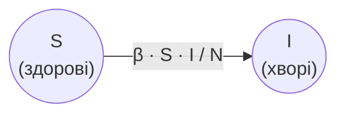

# Змінні -  оновлення значень

## 🧩 Теоретичний матеріал

Змінні зберігають значення під **ім'ям**, і ці значення можна **оновити** під час роботи програми. Таким чином змінні можна використати для відстеженння ***стану*** чогось (грошового балансу, рахуноку у грі, і т.д).

Наприклад, у відеогрі здоров'я героя змінюється після ударів. Змінна `hp` зберігає поточне здоров'я, а програма кілька разів оновлює його і показує стан:

```python
hp = 100
print("Здоров'я героя:", hp)
hp = hp - 20
print("Здоров'я героя:", hp)
hp = hp - 35
print("Здоров'я героя:", hp)
```
***Результат у консолі:***
```
Здоров'я героя: 100
Здоров'я героя: 80
Здоров'я героя: 45
```

Рядок `hp = hp - 20` читають так: взяти поточне значення `hp`, відняти `20` і **записати результат назад** у `hp`.

⚠️ Знак `=` - це дія ***присвоєння***, а не "дорівнює" з математики. Запис `hp = hp - 20` як математичне рівняння був би хибним, але в програмі це нормальна команда: спочатку обчислюється права частина (вираз), потім результат зберігається у змінній.

⚠️ У Python змінну не оголошують за допомогою `let`: достатньо присвоїти їй значення.

## 🎯 Практичне завдання

***Модель SI*** описує поширення хвороби. Кожну людину відносять до однієї з двох груп:

* `S` (susceptible) - здорові (можуть захворіти);
* `I` (infected) - хворі (можуть заразити інших).

Загальна кількість людей $N = S + I$ не змінюється. Кожного дня частина здорових стає хворими. Стрілка на схемі показує цей перехід:



Кількість нових хворих за день:

$$\Delta I = \beta \cdot \frac{S \cdot I}{N}$$

де $\beta$ (`beta`) - ***коефіцієнт зараження***. Після цього стан оновлюють:

$$I_{t + 1} = I_t + \Delta I$$

$$S_{t + 1} = S_t - \Delta I$$

Доповни стартовий код: за допомогою циклу `while` або `for` повторюй крок оновлення і виведення стану для **наступних 100 днів**.

```python
S = float(input("Кількість здорових людей (S):"))
I = float(input("Кількість хворих (I):"))
beta = float(input("Коефіцієнт зараження (β):"))
N = S + I
t = 0

print("День", t, "здорові:", S, "хворі:", I)

# ❗ за допомогою циклу while або for онови стан моделі і виведи його для наступних 100 днів

```

⚠️ Початковий код залиш без змін.

⚠️ Кількість нових хворих рахуй за **поточними** значеннями `S` і `I`, після чого оновлюй змінні і виводь оновлений стан.

💡 Не забудь збільшити `t` на `1` перед виведенням наступного дня.

Нижче наведено початок виводу. Продовжуй виводити стан щодня до **дня 100**.

Якщо користувач введе `50`, потім `50`, потім `1`, початок виводу в консолі має бути таким:
```
День 0 здорові: 50.0 хворі: 50.0
День 1 здорові: 25.0 хворі: 75.0
День 2 здорові: 6.25 хворі: 93.75
День 3 здорові: 0.390625 хворі: 99.609375
```

Якщо користувач введе `990`, потім `10`, потім `0.3`, початок виводу в консолі має бути таким:
```
День 0 здорові: 990.0 хворі: 10.0
День 1 здорові: 987.03 хворі: 12.97
День 2 здорові: 983.18946627 хворі: 16.81053373
День 3 здорові: 978.2310843642863 хворі: 21.76891563571376
```

Якщо користувач введе `100`, потім `0`, потім `0.8`, початок виводу в консолі має бути таким:
```
День 0 здорові: 100.0 хворі: 0.0
День 1 здорові: 100.0 хворі: 0.0
День 2 здорові: 100.0 хворі: 0.0
День 3 здорові: 100.0 хворі: 0.0
```
