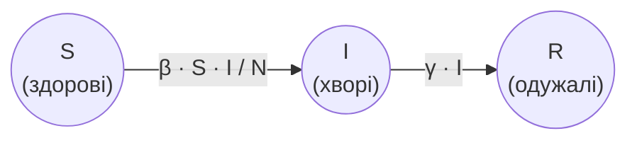

# Практичне завдання - модель SIR

## 🎯 Практичне завдання

***Модель SIR*** описує поширення хвороби, після якої люди **одужують** і більше **не** хворіють. Кожну людину відносять до однієї з трьох груп:

* `S` (susceptible) - здорові (можуть захворіти);
* `I` (infected) - хворі (можуть заразити інших і з часом одужати);
* `R` (recovered) - одужалі (більше не хворіють і не заражають).

Загальна кількість людей $N = S + I + R$ не змінюється. Кожного дня частина здорових стає хворими, а частина хворих одужує і переходить до групи одужалих:



Кількість нових хворих за день:

$$\Delta I = \beta \cdot \frac{S \cdot I}{N}$$

Кількість тих, хто одужав за день:

$$\Delta R = \gamma \cdot I$$

де $\beta$ (`beta`) - ***коефіцієнт зараження***, а $\gamma$ (`gamma`) - ***коефіцієнт одужання***. Після цього стан оновлюють:

$$S_{t + 1} = S_t - \Delta I$$

$$I_{t + 1} = I_t + \Delta I - \Delta R$$

$$R_{t + 1} = R_t + \Delta R$$

Доповни стартовий код: за допомогою циклу `while` або `for` повторюй крок оновлення і виведення стану для **наступних 100 днів**.

```python
S = float(input("Кількість здорових людей (S):"))
I = float(input("Кількість хворих (I):"))
R = float(input("Кількість одужалих людей (R):"))
beta = float(input("Коефіцієнт зараження (β):"))
gamma = float(input("Коефіцієнт одужання (γ):"))
N = S + I + R
t = 0

print("День", t, "здорові:", S, "хворі:", I, "одужалі:", R)

# ❗ за допомогою циклу while або for онови стан моделі і виведи його для наступних 100 днів

```

Нижче наведено початок виводу. Продовжуй виводити стан щодня до **дня 100**.

Якщо користувач введе `50`, потім `50`, потім `0`, потім `1`, потім `0.2`, початок виводу в консолі має бути таким:
```
День 0 здорові: 50.0 хворі: 50.0 одужалі: 0.0
День 1 здорові: 25.0 хворі: 65.0 одужалі: 10.0
День 2 здорові: 8.75 хворі: 68.25 одужалі: 23.0
День 3 здорові: 2.778125 хворі: 60.571875 одужалі: 36.65
```

Якщо користувач введе `990`, потім `10`, потім `0`, потім `0.3`, потім `0.1`, початок виводу в консолі має бути таким:
```
День 0 здорові: 990.0 хворі: 10.0 одужалі: 0.0
День 1 здорові: 987.03 хворі: 11.97 одужалі: 1.0
День 2 здорові: 983.48557527 хворі: 14.317424730000003 одужалі: 2.197
День 3 здорові: 979.2612810609094 хворі: 17.109976466090696 одужалі: 3.6287424730000004
```

Якщо користувач введе `100`, потім `0`, потім `0`, потім `0.8`, потім `0.3`, початок виводу в консолі має бути таким:
```
День 0 здорові: 100.0 хворі: 0.0 одужалі: 0.0
День 1 здорові: 100.0 хворі: 0.0 одужалі: 0.0
День 2 здорові: 100.0 хворі: 0.0 одужалі: 0.0
День 3 здорові: 100.0 хворі: 0.0 одужалі: 0.0
```
