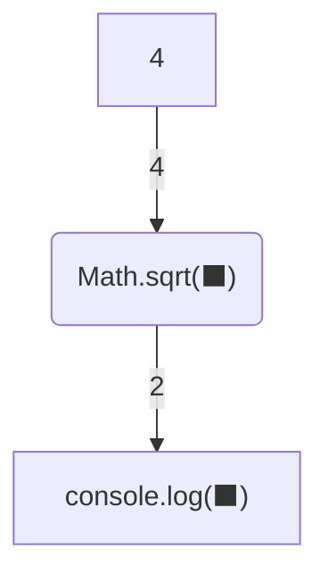

# Вирази - виклик функцій з одним аргументом

## 🧩 Теоретичний матеріал

Деякі функції не лише виконують дію, а й ***повертають*** значення. Таке значення можна використати далі: передати в `console.log` або використати як частину іншого виразу.

Тому ***виклик функції*** теж є виразом: JavaScript спочатку обчислює виклик і отримує повернуте значення.

Наприклад, функція `Math.sqrt` рахує ***квадратний корінь*** числа. У дужках записують один аргумент - число, з якого треба взяти корінь.

***Приклад:***
```javascript
console.log(Math.sqrt(4))
```
***Результат у консолі:***
```
2
```

Візуалізувати процес обчислення такого виразу можна так:


Спочатку обчислюється `Math.sqrt(4)` і повертається `2`. Потім `console.log` виводить це значення.

## 🎯 Практичне завдання

Виведи у консоль квадратний корінь з числа `2`.

⚠️ Обов'язково використай `Math.sqrt`.

У консолі має з'явитися такий текст:
```
1.4142135623730951
```
