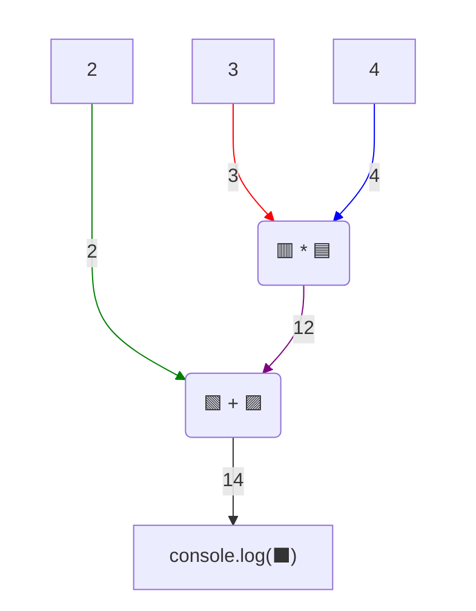
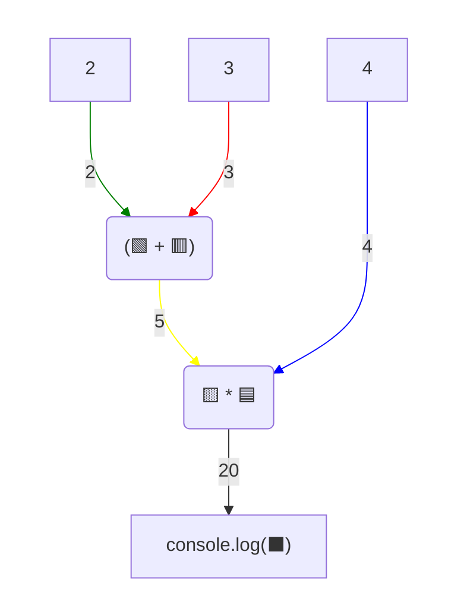

# Вирази - використання дужок

## 🧩 Теоретичний матеріал

Якщо у виразі кілька операторів, JavaScript спочатку виконує операції з вищим ***пріоритетом***. Пріоритет такий самий, як у звичайній математиці: множення `*` і ділення `/` виконуються раніше, ніж додавання `+` і віднімання `-`.

***Приклад:***
```javascript
console.log(2 + 3 * 4)
```
***Результат у консолі:***
```
14
```

Візуалізувати процес обчислення такого виразу можна так:


Спочатку обчислюється множення `3 * 4`, потім до результату додається `2`.

Дужки змінюють порядок обчислення: те, що в дужках, рахується першим.

***Приклад:***
```javascript
console.log((2 + 3) * 4)
```
***Результат у консолі:***
```
20
```

Візуалізувати процес обчислення такого виразу можна так:


Спочатку обчислюється додавання `2 + 3`, результат множиться на `2`.

## 🎯 Практичне завдання

Троє друзів зайшли в кафе. Вони замовили одну піцу на всіх і по одному напою кожен. Рахунок ділять порівну.

* піца - `300` грн;
* Оля замовила чай - `45` грн;
* Марія замовила каву - `55` грн.
* Андрій замовив сік - `50` грн;

Використай JavaScript, щоб порахувати, скільки гривень має заплатити кожен.

⚠️ Обов'язково використай дужки: запиши і додай усі ціни, потім поділи суму на кількість людей. Не рахуй результат вручну.

У консолі має з'явитися такий текст:
```
150
```
