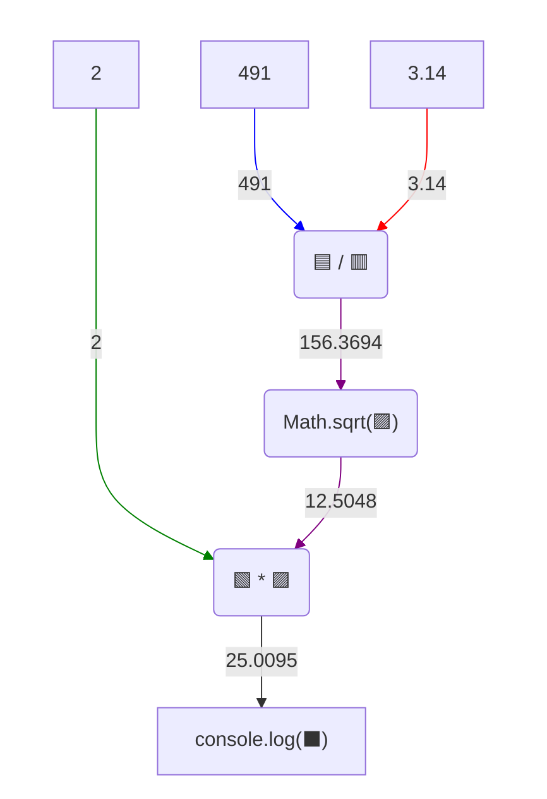

# Вирази - складніші вирази

## 🧩 Теоретичний матеріал

У виразах можна поєднувати оператори, дужки і виклики функцій. JavaScript обчислює такий запис крок за кроком і отримує одне значення.

***Приклад:***
```javascript
console.log((Math.sqrt(25) + 7) / 2)
```
***Результат у консолі:***
```
6
```

Спочатку `Math.sqrt` бере квадратний корінь з `25` і повертає `5`. Потім у дужках групування обчислюється `5 + 7`. Нарешті `12` ділиться на `2`.

⚠️ Дужки групування і дужки виклику функції виглядають однаково, але мають різне значення:
* дужки **групування** змінюють порядок обчислення, як у математиці;
* дужки **виклику функції** стоять одразу після імені функції і у них записують аргументи функції.

Наприклад, аргументом `Math.sqrt` стає **все**, що стоїть у її дужках виклику. Тому ці два вирази дають різні результати:
```javascript
console.log(Math.sqrt(9 + 7))
console.log(Math.sqrt(9) + 7)
```
***Результат у консолі:***
```
4
10
```

У першому рядку корінь беруть від суми `9 + 7`. У другому - лише від `9`, а `7` додають уже після виклику.

## 🎯 Практичне завдання

Кругла піца має площу `491` см². Порахуй її діаметр у сантиметрах.

⚠️ Обов'язково запиши **один** вираз з використанням `Math.sqrt`. Не рахуй результат вручну.

💡 Підказка - процес обчислення потрібного виразу:


У консолі має з'явитися такий текст:

```
25.009552315192877
```
