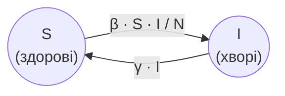

# Змінні - комбіноване присвоєння, інкремент, декремент

## 🧩 Теоретичний матеріал

### Комбіноване присвоєння

Часто оновлювати змінну потрібно **на певне значення**. Замість довгого запису `hp = hp - 20` у JavaScript можна використати ***комбіноване присвоєння***: операція та присвоєння в одному знаку.

`-=` віднімає значення від змінної, `+=` додає значення до змінної.

Наприклад, здоров'я героя падає після ударів, а потім зростає після лікування:

```javascript
let hp = 100
console.log("Здоров'я героя:", hp)
hp -= 20
console.log("Здоров'я героя:", hp)
hp -= 35
console.log("Здоров'я героя:", hp)
hp += 25
console.log("Здоров'я героя:", hp)
```
***Результат у консолі:***
```
Здоров'я героя: 100
Здоров'я героя: 80
Здоров'я героя: 45
Здоров'я героя: 70
```

Рядок `hp -= 20` означає те саме, що `hp = hp - 20`: взяти поточне значення `hp`, відняти `20` і записати результат назад у `hp`.

### Інкремент і декремент

Коли змінну потрібно змінити **на 1**, замість `+= 1` і `-= 1` можна використати ***інкремент*** `++` (додає `1`) або ***декремент*** `--` (віднімає `1`).

Наприклад, у героя відеогри три життя, і після підбору додаткового життя стає на одне більше:

```javascript
let lives = 3
lives++
console.log("Життя героя:", lives)
```
***Результат у консолі:***
```
Життя героя: 4
```

## 🎯 Практичне завдання

***Модель SIS*** описує поширення хвороби, після якої люди **одужують** і знову можуть захворіти. Кожну людину відносять до однієї з двох груп:

* `S` (susceptible) - здорові (можуть захворіти);
* `I` (infected) - хворі (можуть заразити інших і з часом одужати).

Загальна кількість людей $N = S + I$ не змінюється. Кожного дня частина здорових стає хворими, а частина хворих одужує і повертається до групи здорових:



Зміна кількості хворих за день:

$$\Delta I = \beta \cdot \frac{S \cdot I}{N} - \gamma \cdot I$$

де $\beta$ (`beta`) - ***коефіцієнт зараження***, а $\gamma$ (`gamma`) - ***коефіцієнт одужання***. Після цього стан оновлюють:

$$I += \Delta I$$

$$S -= \Delta I$$

Доповни стартовий код: повтори крок оновлення і виведення стану для **наступних 3 днів**.

```javascript
let S = Number(prompt("Кількість здорових людей (S):"))
let I = Number(prompt("Кількість хворих (I):"))
let beta = Number(prompt("Коефіцієнт зараження (β):"))
let gamma = Number(prompt("Коефіцієнт одужання (γ):"))
let N = S + I
let i = 0

console.log("День", i, "здорові:", S, "хворі:", I)

// ❗ онови стан моделі і виведи його для наступних 3 днів

```

⚠️ Початковий код залиш без змін.

⚠️ $\Delta I$ рахуй за **поточними** значеннями `S` і `I`, після чого оновлюй змінні і виводь оновлений стан.

⚠️ Використай `+=`, `-=`, `++`.

Якщо користувач введе `50`, потім `50`, потім `1`, потім `0.2`, у консолі має з'явитися:
```
День 0 здорові: 50 хворі: 50
День 1 здорові: 35 хворі: 65
День 2 здорові: 25.25 хворі: 74.75
День 3 здорові: 21.325625000000002 хворі: 78.674375
```

Якщо користувач введе `990`, потім `10`, потім `0.3`, потім `0.1`, у консолі має з'явитися:
```
День 0 здорові: 990 хворі: 10
День 1 здорові: 988.03 хворі: 11.97
День 2 здорові: 985.67898427 хворі: 14.32101573
День 3 здорові: 982.8763085714617 хворі: 17.123691428538326
```

Якщо користувач введе `100`, потім `0`, потім `0.8`, потім `0.3`, у консолі має з'явитися:
```
День 0 здорові: 100 хворі: 0
День 1 здорові: 100 хворі: 0
День 2 здорові: 100 хворі: 0
День 3 здорові: 100 хворі: 0
```
