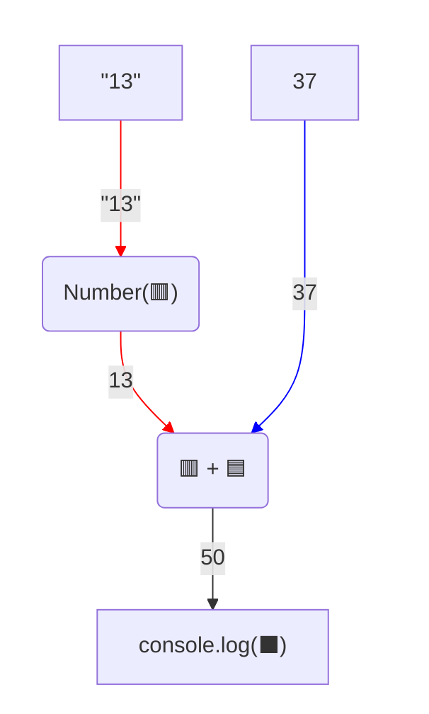

# Перетворення типів

## 🧩 Теоретичний матеріал

***Перетворення типів*** - це створення нового значення іншого типу на основі наявного. Воно потрібне, коли значення має не той тип, який потрібно.

Щоб перетворити тип значення, використовують функції `Number` і `String`. Наприклад:
* `Number("7")` - повертає значення `7` (число);
* `String(7)` - повертає значення `"7"` (рядок тексту).

Оператор `+` працює по-різному залежно від типів операндів. Якщо тип значення не відповідає тому обчисленню, яке потрібно виконати - можна перетворити тип значення у виразі:

***Приклад:***
```javascript
console.log(Number("13") + 37)
console.log(String(13) + 37)
```
***Результат у консолі:***
```
50
1337
```

У першому рядку `Number("13")` повертає число `13`, тож `+` додає числа і дає `50`. У другому `String(13)` повертає рядок `"13"`, тож `+` склеює `"13"` і `"37"` у `"1337"`.

Візуалізувати процес обчислення першого виразу можна так:


## 🎯 Практичне завдання

У програмі нижче два вирази дають неочікуваний результат, бо типи операндів не відповідають задуму.

1. Перший вираз мав додати числа `35` і `7`.
2. Другий вираз мав склеїти текст `"6"` і `"7"`.

Виправ кожен вираз за допомогою `Number` або `String`.

⚠️ Не змінюй самі значення (`"35"`, `7`, `6`, `7`) - зміни лише їхні типи через перетворення.

```javascript
// ❗ 1. перетвори рядок на число, щоб отримати суму:
console.log("35" + 7)
// ❗ 2. перетвори числа на рядки, щоб склеїти текст:
console.log(6 + 7)
```

Після виправлення у консолі має з'явитися такий текст:

```
42
67
```
