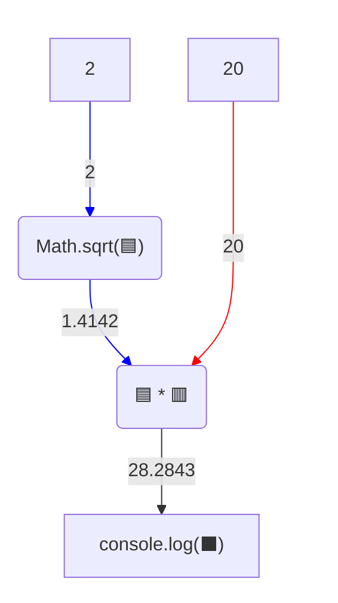

# Практичне завдання - діагональ коробки

## 🎯 Практичне завдання

Квадратна коробка для піци має сторону `20` см. Порахуй її діагональ у сантиметрах.

⚠️ Обов'язково запиши **один** вираз з використанням `Math.sqrt`. Не рахуй результат вручну.

💡 Процес обчислення потрібного виразу:


У консолі має з'явитися такий текст:

```
28.284271247461902
```
