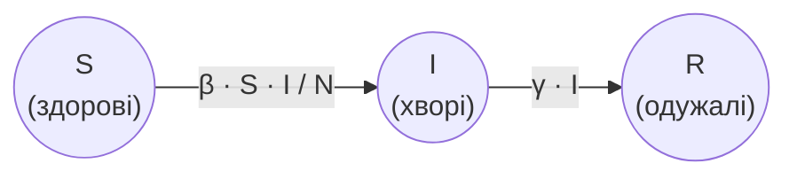

# Практичне завдання - модель SIR

## 🎯 Практичне завдання

***Модель SIR*** описує поширення хвороби, після якої люди **одужують** і більше **не** хворіють. Кожну людину відносять до однієї з трьох груп:

* `S` (susceptible) - здорові (можуть захворіти);
* `I` (infected) - хворі (можуть заразити інших і з часом одужати);
* `R` (recovered) - одужалі (більше не хворіють і не заражають).

Загальна кількість людей $N = S + I + R$ не змінюється. Кожного дня частина здорових стає хворими, а частина хворих одужує і переходить до групи одужалих:



Кількість нових хворих за день:

$$\Delta I = \beta \cdot \frac{S \cdot I}{N}$$

Кількість тих, хто одужав за день:

$$\Delta R = \gamma \cdot I$$

де $\beta$ (`beta`) - ***коефіцієнт зараження***, а $\gamma$ (`gamma`) - ***коефіцієнт одужання***. Після цього стан оновлюють:

$$S_n = S_{n - 1} - \Delta I$$

$$I_n = I_{n - 1} + \Delta I - \Delta R$$

$$R_n = R_{n - 1} + \Delta R$$

Доповни стартовий код: повтори крок оновлення і виведення стану для **наступних 3 днів**.

```javascript
let S = Number(prompt("Кількість здорових людей (S):"))
let I = Number(prompt("Кількість хворих (I):"))
let R = Number(prompt("Кількість одужалих людей (R):"))
let beta = Number(prompt("Коефіцієнт зараження (β):"))
let gamma = Number(prompt("Коефіцієнт одужання (γ):"))
let N = S + I + R
let i = 0

console.log("День", i, "здорові:", S, "хворі:", I, "одужалі:", R)

// ❗ онови стан моделі і виведи його для наступних 3 днів

```

Якщо користувач введе `50`, потім `50`, потім `0`, потім `1`, потім `0.2`, у консолі має з'явитися:
```
День 0 здорові: 50 хворі: 50 одужалі: 0
День 1 здорові: 25 хворі: 65 одужалі: 10
День 2 здорові: 8.75 хворі: 68.25 одужалі: 23
День 3 здорові: 2.778125 хворі: 60.571875 одужалі: 36.65
```

Якщо користувач введе `990`, потім `10`, потім `0`, потім `0.3`, потім `0.1`, у консолі має з'явитися:
```
День 0 здорові: 990 хворі: 10 одужалі: 0
День 1 здорові: 987.03 хворі: 11.97 одужалі: 1
День 2 здорові: 983.48557527 хворі: 14.317424730000003 одужалі: 2.197
День 3 здорові: 979.2612810609094 хворі: 17.109976466090696 одужалі: 3.6287424730000004
```

Якщо користувач введе `100`, потім `0`, потім `0`, потім `0.8`, потім `0.3`, у консолі має з'явитися:
```
День 0 здорові: 100 хворі: 0 одужалі: 0
День 1 здорові: 100 хворі: 0 одужалі: 0
День 2 здорові: 100 хворі: 0 одужалі: 0
День 3 здорові: 100 хворі: 0 одужалі: 0
```
